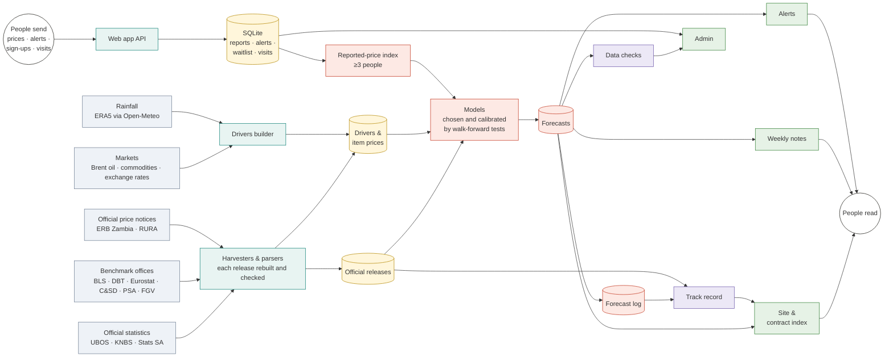

# CiO Costs — Project Overview, Data Flow and Hosting

*Owner: Gavamukulya (Gava) Charles, CiO Lab · Repository: `gavacharles/cio-construction-costs` (private) · Version: 23 October 2026*

This file covers what the platform is, how its data flows, what gets hosted and what it costs.
For how the forecasts work, see `FORECASTING.md`; for running it day to day, `docs/OPERATIONS.md`;
for installing a server, `docs/DEPLOY.md`.

---

## 1. What the platform is

**CiO Costs forecasts construction costs (materials, fuel and labour) and collects the prices
people actually pay.** Official construction price figures arrive months late (Uganda: about
6 months), every quarter (Kenya), or not at all (Rwanda, Tanzania, Zambia, Nigeria). CiO Costs
fills that gap with forecasts that have a range, tested in public.

| Part | What it does | For whom |
|---|---|---|
| **Forecasts** | Expected change in construction costs, for the whole market and each material, for any date in the next year, with a likely range (8 in 10) | Contractors, quantity surveyors, clients, lenders |
| **Weekly notes** | A short plain-language note for each country every week: what is likely to happen, what it means for your money, prices to watch | Everyone; shared on WhatsApp |
| **Bids & contracts** | Bill of quantities escalation for bids; FIDIC price adjustment (Sub-Clause 13.7/13.8) for Interim Payment Certificates, with a contract index | Contracting parties |
| **Price reports** | Anyone reports what they paid (anonymous, no account). Published only as a typical price once 3 people report an item in 2 months | Contributors; feeds the forecasts and the contract index |
| **Track record** | Every forecast is logged and scored when the official figure comes out | Everyone: shows whether to trust it |
| **The Cost Call** | A daily game on real prices (points only, no money) | Brings people back |

**Countries:** 7 live pilot countries — Uganda, Kenya, South Africa (official indices), Rwanda,
Tanzania, Zambia, Nigeria (no official index: estimates). 6 benchmark countries with good
official data — United States, United Kingdom, Austria, Hong Kong, Philippines, Brazil — show how
the method performs where the truth is known quickly.

**Free during the pilot.** CiO Costs Pro (more IPCs, saved contracts, branded statements, data
feed) has a waitlist. The assistant (Claude: data scout, contract reader) is built but switched
off until there is a budget (`assistant: false` in `config/site.yaml`, no API key).

## 2. How data flows through the platform



Picture version (for viewers that do not draw diagrams): [docs/data_flow.png](docs/data_flow.png)

*Colours: grey = sources · teal = collect · yellow = stored data · red = forecast engine · purple =
checks · green = publish · white circles = people. "People read" and "People send" are the same
people: what they read brings some of them back as contributors.*

### Reading the diagram

Data moves left to right in six stages (the colours). Boxes are processes, cylinders are stored data, circles are people.

1. **Outside sources.** Five kinds of data come from outside, plus what people send in.
   Official statistics are the "truth" the forecasts are judged against. Markets and rainfall
   are the *drivers*: they move before official figures do, which is what makes a forecast
   possible.
2. **Collect.** Scheduled jobs fetch and read each source. Every official release is rebuilt
   from its own weights and checked before it is stored; scanned Kenyan releases are read by OCR
   and accepted only when they match the text releases. People's input arrives through the web
   app's small public API: prices, alert sign-ups, Pro waitlist and anonymous visit counts.
3. **Stored data.** Three stores: official releases per country, shared driver files, and one
   SQLite database for everything people send. Nothing personal is ever published.
4. **Forecast engine.** Every 3 hours the models are re-run on the latest drivers. Each
   material's model is chosen by a walk-forward test (chosen on the first half of the test
   period, judged on the second) against plain "no change", and ranges are calibrated on the
   errors the model actually made. Reported prices become an index once 3 people report an item,
   and that index feeds the estimates for countries without official data.
5. **Checks.** Data checks look for gaps, jumps, stale data and poor range coverage after every
   run. Every published forecast is logged; when the official figure arrives it is scored, and
   the score becomes the public track record.
6. **Publish.** The site builder writes the static pages and the contract index files; the
   weekly notes and alerts go out; the admin page shows checks, the waitlist and the monthly
   pilot report. What people read brings some of them back as contributors — the loop closes.

### Dependencies and interdependencies

| If this changes or fails… | …this is affected | How it is handled |
|---|---|---|
| A new official release (e.g. UBOS) | Models are re-tested and may switch (e.g. cement from "no change" to a driver model); the track record scores the forecasts it settles; the contract index replaces provisional values | Daily harvest; automatic re-selection every run |
| Oil or exchange rate moves | All forecasts, the cost-pressure estimates, the notes, alerts | Refreshed every 3 hours |
| People report prices | Reported-price index → estimates for Rwanda, Tanzania, Zambia, Nigeria → contract index (as "reported") | Published only with ≥3 people; typo and outlier checks at entry |
| A source is down or changes format | Its country goes stale; the rest continue | Data checks flag it in admin; last good data is kept |
| The forecast log | Track record, calibration of ranges (last 24 known errors) | Append-only; no hindsight: an error is used only once it was knowable |
| The site build | Everything people see | Strict JSON (no NaN/Infinity), 50 automated tests, JS error probe |

**Two interdependencies to keep in mind:**

- **Forecasts ↔ track record.** The ranges are widened or narrowed from past errors, and the
  track record judges the ranges. The rule that stops this from cheating is that only errors that
  were knowable at the time are used.
- **People ↔ forecasts.** Reported prices improve the estimates, and better estimates bring more
  people. Until 3 people report an item, it has no effect at all — so recruitment density in one
  city matters more than spread across many.

### Why the site and the notes can show different numbers

The site measures change **from the last official figure** (Uganda: April 2026); the notes
measure it **from today**. Both are correct, but they answer different questions. The gap equals
the change the model thinks has already happened since the last official month, so it is largest
where official data is oldest. To January 2027, as of 23 October 2026:

| Country | Last official | From last official | From today | Gap |
|---|---|---|---|---|
| Uganda | Apr 2026 | +5.6% | +2.6% | 3.0 points |
| Kenya | Q2 2026 | +2.5% | +1.0% | 1.6 |
| South Africa | Aug 2026 | +2.5% | +1.6% | 0.9 |
| Benchmarks | 1–3 months | — | — | 0.1–1.4 |
| Rwanda, Tanzania, Zambia, Nigeria | estimate up to today | — | — | none |

Recommended: measure from today wherever people price work (headline, "Allow about…", your-price
calculator, material list), and keep "since the last official figure" only for the contract
index, where FIDIC needs it.

## 3. What gets hosted

| # | Service | What it is | Public? |
|---|---|---|---|
| 1 | **Public site** | `public/` (built by `src/site/build_index.py`), served at `/`: landing and forecast, a page per country, Weekly notes, Bids & contracts, Report a price, Play, Costs at a glance, methodology, terms, privacy, widget for other websites. English, Kiswahili, French | Yes |
| 2 | **Public API** | `POST /api/public/price` (anonymous prices; 30 per IP per hour), `/alert`, `/waitlist`, `/hit` (anonymous visit counts: no cookies, no IP stored) | Yes |
| 3 | **Admin** | `/admin` (password): data checks, pilot reports, Pro waitlist, data scout (when switched on) | Organiser only |
| 4 | **Scheduled jobs** | Daily harvest, 3-hourly refresh, weekly notes, monthly pilot report, nightly backup | No |
| 5 | **Database** | One SQLite file (`data/live/exchange.sqlite`) | Never exposed |

## 4. Architecture

```
                 Internet (phones / laptops)
                            │  HTTPS 443
                 ┌──────────▼──────────┐
                 │  Caddy (TLS, HSTS)  │   or Cloudflare in front
                 └──────────┬──────────┘
                            │  http 127.0.0.1:8000
                 ┌──────────▼──────────┐
                 │ Uvicorn + FastAPI   │  serves public/ and the API (systemd `cio-app`)
                 └──────────┬──────────┘
   ┌────────────────────────▼─────────────────────────┐
   │ /srv/cio-construction-costs                       │
   │   public/                 the built site          │
   │   data/live/exchange.sqlite   reports, visits     │
   │   countries/<c>/raw, outputs, notes               │
   │   data/shared/            drivers                  │
   └────────────────────────▲─────────────────────────┘
                            │ cron: daily · every 3 h · weekly · monthly · nightly backup
                            │ outbound HTTPS only
 UBOS · KNBS · Stats SA · FRED · Eurostat · BCB · C&SD · PSA · ERB · currency API · Open-Meteo
```

Server: one VM, 2 vCPU, 2 GB RAM, 40 GB SSD, Ubuntu 24.04, region nearest East Africa
(Johannesburg or Frankfurt). Details in `docs/DEPLOY.md`.

## 5. Scheduled jobs (`deploy/crontab.example`, East Africa Time)

| When | Command | What it does |
|---|---|---|
| Daily 06:30 | `cycle.py daily` | Harvest UBOS, KNBS (with OCR), Stats SA, benchmarks, world commodities, official item prices; re-test and re-fit when a new release arrives |
| Every 3 hours | `cycle.py refresh` | Drivers → all forecasts → data checks → site → alerts |
| Monday 05:00 | `cycle.py weekly` | Rainfall, exchange-rate history, weekly notes |
| 1st of month | `cycle.py monthly` | Pilot report |
| Nightly 02:00 | `deploy/backup.sh` | Database backup, 30 days kept |

Every step is logged to `data/live/cycle_log.csv`.

## 6. Configuration and secrets (`/etc/cio/cio.env`)

| Variable | Purpose |
|---|---|
| `CIO_ADMIN_KEY` | Organiser password for `/admin` (`openssl rand -base64 24`) |
| `CIO_DB` | Database file |
| `CIO_SECURE_COOKIES` | `1` in production |
| `ANTHROPIC_API_KEY`, `CIO_AI_MONTHLY_USD` | Only when the assistant is switched on |
| SMTP / WhatsApp settings | Only when alerts are sent automatically |

## 7. Security and data protection

- HTTPS only; `X-Frame-Options: DENY` except the widget; admin login rate-limited.
- No accounts. Price reports are anonymous (salted hash of the IP); visits are counted without
  cookies or IP. Single reports, names, numbers and emails are never published.
- Terms and privacy pages are drafts: have them reviewed by a lawyer (jurisdiction assumed
  Uganda; Data Protection and Privacy Act 2019).

## 8. Infrastructure costs

| Item | Now (demo) | Pilot in production | Growth (thousands of users) |
|---|---|---|---|
| Server | Your laptop + free Cloudflare quick tunnel (link changes when it restarts) | 2 GB VM: about **US$5–12/month** (Hetzner about €4–5; DigitalOcean/Lightsail about $10–12) | 4 GB VM about $20–25; still SQLite |
| Domain | — | About **$10–15/year** | Same |
| TLS, DNS, caching | Free | Free (Let's Encrypt / Cloudflare free plan) | Free |
| Backups off the server | — | About **$1/month** (object storage) | $1–5 |
| Uptime monitor | — | Free (e.g. UptimeRobot) | Free |
| Email alerts | — | Free tier of an email service (a few hundred a day) | $10–20 |
| WhatsApp | Free channel, posted by hand | Same | WhatsApp API is paid per message: only with a budget |
| Data sources | Free | Free; **check Open-Meteo's terms once Pro is paid** (its free API is for non-commercial use; rainfall can instead come directly from Copernicus ERA5, free) | Same |
| Assistant (Claude) | Off | Off | Optional, capped (default $30/month) |
| **Total** | **$0** | **about $7–15/month** | **about $35–60/month** |

The main cost is not infrastructure: it is time for outreach, checking data and answering users.

## 9. Roadmap

1. **Production server and domain** for the pilot (replaces the quick tunnel).
2. **Uganda first, in depth:** Kampala contributors to reach 3 reports for the core items;
   compare the forecasts for the months UBOS has not published with the figures when they arrive.
3. **Self-checking:** alerts to the organiser when a job or check fails; a daily headless
   "visitor" that opens every page in every language; publish only when checks pass.
4. **Pooled models** across countries and materials, adopted only where they beat the current
   models in the same walk-forward test.
5. **CiO Costs Pro** once the waitlist shows demand.

## 10. Where things are in the repository

| Path | Contents |
|---|---|
| `src/ingest/` | Harvesters and parsers for each source |
| `src/forecast/` | Models (`weekly_note.py`, `material_models.py`), notes (`plain_note.py`), data checks |
| `src/market/` | Price reports and database (`reports.py`), cycle, alerts, usage, pilot report |
| `src/site/` | Site builder, `site.js`, `site.css`, translations (`i18n.js`) |
| `src/webapp/` | FastAPI app: public API and admin |
| `src/ai/` | Assistant (off): data scout, contract reader |
| `countries/<c>/` | Each country's config, official releases, outputs, notes |
| `data/shared/` | Drivers, commodities, rainfall, official item prices |
| `config/` | `site.yaml` (countries, operator, switches), `scout.yaml` |
| `deploy/` | systemd unit, Caddyfile, env template, crontab, backup script |
| `docs/` | Operations, deployment, forecast model, countries |
| `tests/` | 50 automated tests (`pytest -q`) |
